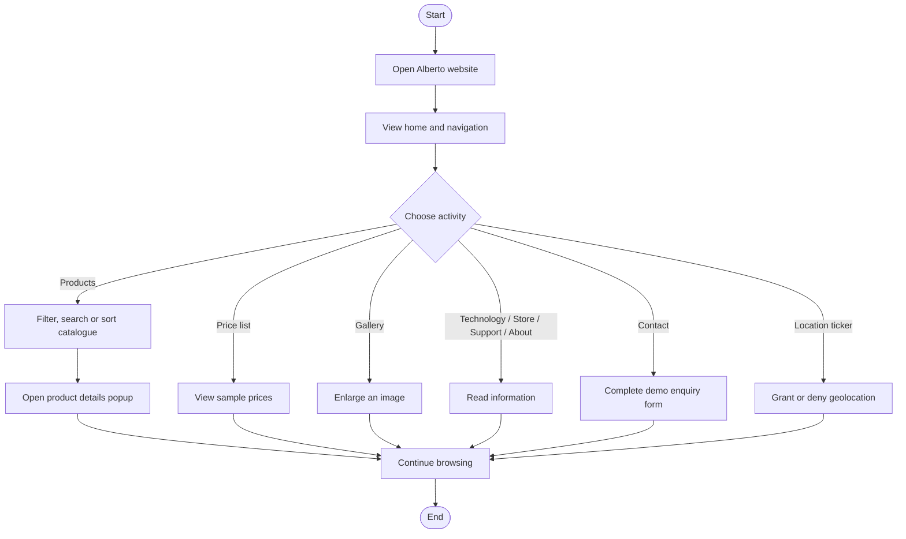

# Alberto Watch Company — Aptech eProject Report

## 1. Problem definition
Alberto Watch Company is described in the supplied brief as a full-service watch repair, appraisal and retail store offering luxury timepieces, including examples such as Michael Kors, Rolex, Citizen Eco-Drive and Bulova. The project is a responsive single-page website for browsing products and company services.

## 2. Objectives
- Present the company with a polished, responsive interface.
- Organize products into Luxury, Vintage, Smart, Classic and Clock categories.
- Display product details in popup windows and provide a complete price list.
- Include technology, gallery, store locator, support, about, contact and sitemap sections.
- Display a visitor count and a continuous bottom ticker with date, time and optional geolocation.

## 3. Technology stack
- Authentication: PHP API with sessions; user records are stored in data/users.json and passwords use PHP password_hash().

## 4. Modules
1. Header, logo, navigation and visitor counter.
2. Hero and company introduction.
3. Product catalogue with category filters, search and sorting.
4. Product detail modal.
5. Technology information.
6. Price list and image gallery modal.
7. Store locator, about, team and support sections.
8. Contact enquiry form demonstration.
9. Live ticker with date/time and click-initiated geolocation.

## 5. Activity flow

## 6. Data flow overview
- `products.js` → `script.js` → product cards and price list.
- Category/search/sort input → filtered catalogue → product cards.
- Product selection → product ID lookup → Bootstrap modal.
- Authentication: PHP API with sessions; user records are stored in data/users.json and passwords use PHP password_hash().
- User clicks location ticker → browser geolocation permission → coordinates or unavailable message.
- Contact form submit → front-end validation → demo confirmation; no server transmission.

## 7. Test cases
| ID | Test | Expected result |
|---|---|---|
| T01 | Open `index.html` | Website loads in a modern browser |
| T02 | Select Luxury filter | Only Luxury items display |
| T03 | Select Clocks filter | Clock products display |
| T04 | Search for Rolex | Matching product displays |
| T05 | Sort by price low-to-high | Products sort by ascending price |
| T06 | Open a product card | Correct details appear in popup |
| T07 | View price list | All catalogue products and prices display |
| T08 | Click a gallery tile | Enlarged image modal opens |
| T09 | Submit empty contact form | Required-field validation appears |
| T10 | Submit valid contact form | Demo confirmation appears; no message is sent |
| T11 | Reload in same browser | Local visitor counter increments |
| T12 | Click ticker location | Browser requests location permission |
| T13 | Resize to mobile width | Layout adapts to narrow screen |
| T14 | Select mobile navigation link | Section opens and menu collapses |

## 8. Installation instructions
1. Extract the ZIP folder.
2. Open `index.html` in a modern browser.
3. Internet access is recommended for external fonts, CDN libraries and remote images.
4. Use localhost or HTTPS for geolocation and grant permission after clicking the location label.

## 9. Assumptions and limitations
- The supplied brief does not provide verified company address, email or phone details; the displayed details are placeholders.
- Product names, references, photos and prices are sample data and are not official company inventory or quotations.
- The visitor counter is browser-local and not a shared analytics service.
- The contact form is front-end only and requires a backend/API to receive enquiries.
- Geolocation is optional and only requested after a visitor action.

## 10. Conclusion
The website implements the principal functional requirements in the supplied Alberto Watch Company eProject brief with a responsive single-page design and interactive product catalogue.

## Authentication implementation
Registration and login use api/auth.php. The PHP API reads and writes data/users.json, hashes passwords using password_hash(), verifies them with password_verify(), and maintains login state with PHP sessions. Run the site through XAMPP at localhost; opening the HTML file directly will not run PHP.

## Backend and e-commerce implementation
The project uses PHP endpoints with JSON file storage. MySQL is not required for this implementation.
- Customer accounts: `data/users.json` (passwords hashed using `password_hash`).
- Administrator accounts: `data/admins.json`, created once using `admin/setup.php`.
- Catalogue: `data/products.json`, editable from the admin dashboard.
- Orders: `data/orders.json`, created at checkout using server-side product prices.
- Enquiries: `data/messages.json`, populated by the public footer contact form.
- Sessions: PHP sessions distinguish `customer` and `admin` roles. Admin-only API actions reject customer sessions.
- Cart: browser local storage for the shopping bag; checkout revalidates product IDs and prices on the server.
- Admin: dashboard metrics, order status management, messages inbox/status, product CRUD and customer listing.

## Installation and admin setup
1. Extract the project to `C:/xampp/htdocs/alberto-watch-2-main`.
2. Start Apache in XAMPP.
3. Ensure the `data` folder is writable by the Apache/PHP process.
4. Visit `http://localhost/alberto-watch-2-main/admin/setup.php` and create the first administrator.
5. Sign in at `http://localhost/alberto-watch-2-main/admin/`.
6. Visit `http://localhost/alberto-watch-2-main/` for the customer website.

## Suggested test cases
1. Register a customer and verify a hashed record appears in `data/users.json`.
2. Log in as customer and add two different watches to cart.
3. Change quantity and place an order with phone and delivery address.
4. Confirm order appears in customer order history and admin Orders.
5. Submit the footer contact form and confirm the message appears in admin Messages.
6. Change message status and order status from the admin dashboard.
7. Add/edit/delete a product from admin and refresh the customer catalogue.
8. Confirm a customer account cannot access admin-only API actions or admin dashboard data.

## Data and security notes
This JSON-backed implementation is intended for a local Aptech student eProject. Keep `data/.htaccess` in place, use a strong administrator password, and back up the data folder. For a public commercial deployment, migrate storage to MySQL and add CSRF protection, rate limiting, HTTPS, audit logging and stronger concurrent-write handling. Product names, inventory, contact details and prices are sample project data.
